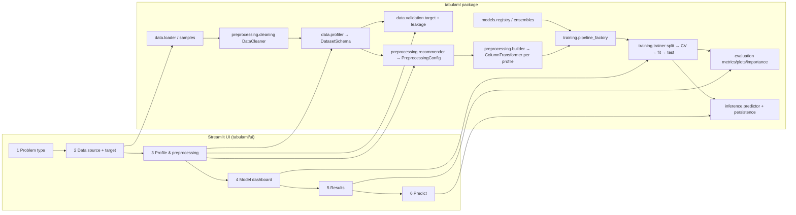
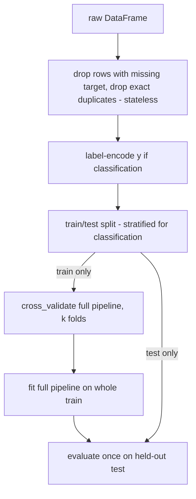

# TabulaML — Tech Stack & System Architecture

## 1. Tech stack

### 1.1 Decisions

| Layer | Choice | Version (minimum; pin exact versions in `requirements.txt` after Phase 0) | Why this, and not the alternative |
|---|---|---|---|
| Language | **Python** | 3.12 (installed: 3.12.2) | All the required ML libraries are Python, so there is a single language end to end. |
| UI framework | **Streamlit** | ≥ 1.38 | It builds a multi-step data app in pure Python, with built-in file upload, `data_editor` for per-column overrides, session state and an `AppTest` testing API. **Rejected: FastAPI + React.** That would mean twice the code, two languages and an API layer the assignment does not need. The core package is UI-agnostic, so a REST API can be added later without rewriting anything. |
| Data handling | **pandas** | ≥ 2.2 | The standard for tabular data. sklearn's `set_output(transform="pandas")` keeps column names through pipelines. |
| Numerics | **NumPy** | ≥ 1.26, < 2.3 | Required by everything else. |
| Core ML / pipelines | **scikit-learn** | ≥ 1.5, < 1.6 at first (see risk R1) | `Pipeline`, `ColumnTransformer`, `TargetEncoder` (cross-fitted), `OneHotEncoder(min_frequency, handle_unknown="infrequent_if_exist")`, Bagging/Voting/Stacking, `permutation_importance`, CV utilities. |
| Gradient boosting | **XGBoost** | ≥ 2.0 | Required comparison model. |
| | **LightGBM** | ≥ 4.3 | Required comparison model. Fast on larger data. |
| | **CatBoost** | ≥ 1.2.5 | Required comparison model. Strong with categorical data. |
| Imbalance | **imbalanced-learn** | ≥ 0.12 | `imblearn.pipeline.Pipeline` applies SMOTE or undersampling **only while fitting**, which is the leakage-safe way to do it. |
| Statistics | **SciPy** | ≥ 1.11 | Skewness, Wilcoxon test in the benchmark. |
| Charts | **Plotly** | ≥ 5.20 | Interactive charts in Streamlit (confusion matrix heatmap, ROC/PR, box plots). |
| Excel I/O | **openpyxl** (xlsx), **xlrd** (xls) | latest | Excel upload support. |
| Persistence | **joblib** | ≥ 1.3 | Standard way to serialise sklearn pipelines. Bundles carry version metadata. |
| Testing | **pytest**, **pytest-cov**, `streamlit.testing.v1.AppTest` | latest | Unit, integration and UI smoke tests. 80 % coverage gate on `tabulaml/`. |
| Lint/format | **ruff** | latest | One tool for linting and formatting. |
| Optional stretch | `shap` (S2), `statsmodels` (S3, ARIMA) | — | Not installed for the core. |
| Packaging | `requirements.txt` + `pyproject.toml` (tool config, editable install) | — | Simple to install: `pip install -r requirements.txt && pip install -e .`. |
| Environment | `venv` at `.venv/` | — | `python -m venv .venv`. |
| Knowledge graph | Graphify (`graphify update .`) | — | Global rule: keeps the code graph current for token-efficient sessions. |

No database is used. State lives in the Streamlit session, and artefacts are written to `artifacts/` (git-ignored).

### 1.2 Known risks

| ID | Risk | Mitigation |
|---|---|---|
| R1 | scikit-learn ≥ 1.6 changed the estimator-tag API (`__sklearn_tags__`). Some XGBoost/CatBoost versions break inside `StackingClassifier`/`clone`. | Start with `scikit-learn>=1.5,<1.6`. Phase 4 has a test that clones and stacks every model. Upgrade only if that test passes. |
| R2 | CatBoost and LightGBM print a lot of output and LightGBM warns about feature names. | `verbose=0` / `verbosity=-1`, and silence specific warnings in the registry factory. |
| R3 | XGBoost requires integer class labels. | The trainer always label-encodes the classification target (P11). |
| R4 | SMOTE cannot sit inside every Stacking/Voting base learner cleanly. | SMOTE and undersampling apply to single-model pipelines. Ensembles fall back to `class_weight` where it is supported, and the UI says so. |
| R5 | Long training runs freeze the UI. | Train sequentially with a progress callback and `n_jobs=-1` inside the models. The recommended set is kept small. |
| R6 | Pickle security. | Load only bundles produced by this app, and show a UI warning. Never load user-supplied pickles automatically. |

## 2. Architecture overview

Layered: **UI (Streamlit) → Services (pure Python package `tabulaml`) → Libraries**. The UI has no ML logic. Every function in `tabulaml/` is testable without Streamlit.



### 2.1 Leakage-safe training flow



**Full pipeline for one model** (an `imblearn.pipeline.Pipeline`, so samplers run only during `fit`):

```
[cleaner: DataCleaner]           # learns coercions from train (P1)
 → [features: ColumnTransformer]  # built from config + profile (P6–P8, P10)
 → [sampler: SMOTE|RUS]           # optional, classification only (P9)
 → [model: estimator]
(regression with log1p: wrapped in TransformedTargetRegressor)
```

Ensembles: each base learner is a complete `cleaner → features → model` pipeline matching its own profile. These are combined in `VotingX`/`StackingX`. This gives heterogeneous preprocessing inside a single estimator, and it stays leakage-safe because stacking uses internal CV.

## 3. Package layout

```
TabulaML/
├── app.py                         # Streamlit entry: page config + step router
├── tabulaml/
│   ├── __init__.py
│   ├── config.py                  # constants: limits, thresholds, tokens, seeds
│   ├── core/types.py              # enums + frozen dataclasses (contracts below)
│   ├── data/
│   │   ├── loader.py              # read_tabular_file(), size checks
│   │   ├── samples.py             # SAMPLE_REGISTRY, load_sample(), DatasetCard
│   │   ├── profiler.py            # infer_feature_type(), profile_dataset()
│   │   └── validation.py          # validate_target(), detect_leakage(), check_supported()
│   ├── preprocessing/
│   │   ├── cleaning.py            # DataCleaner transformer
│   │   ├── transformers.py        # DatetimeFeatures, OutlierClipper, SkewCorrector, TextStats
│   │   ├── recommender.py         # recommend_config() + explanations
│   │   └── builder.py             # build_feature_transformer(config, profile)
│   ├── models/
│   │   ├── registry.py            # ModelSpec, MODEL_REGISTRY, list_models()
│   │   └── ensembles.py           # build_voting(), build_stacking(), HybridRFANNRegressor
│   ├── training/
│   │   ├── pipeline_factory.py    # build_model_pipeline()
│   │   └── trainer.py             # train_models() → TrainingRun
│   ├── evaluation/
│   │   ├── metrics.py             # compute_metrics(), scorer maps, primary metric
│   │   ├── plots.py               # plotly figure builders (pure functions)
│   │   └── importance.py          # permutation importance on raw columns
│   ├── inference/
│   │   ├── predictor.py           # Predictor: validate_input, predict_one, predict_batch
│   │   └── persistence.py         # save_bundle(), load_bundle()
│   └── ui/
│       ├── state.py               # session-state helpers, step gating
│       ├── components.py          # shared widgets (stepper, dataset card, metric tiles)
│       └── steps/ s1_problem.py s2_data.py s3_preprocess.py s4_models.py s5_results.py s6_predict.py
├── data/samples/                  # public data: lk_tea_auction.csv (+2 cards), lk_colombo_dengue.csv/.json
├── scripts/ fetch_public_datasets.py  benchmark.py
├── tests/ unit/ integration/ ui/  conftest.py
├── reports/                       # benchmark outputs, figures (committed)
├── artifacts/                     # saved bundles (git-ignored)
└── docs/
```

## 4. Contracts (source of truth — implement exactly these)

> **Implemented-version deltas** (numpy output from the builder, `recommend_config(..., y)`, `build_model_pipeline(..., base_keys, as_base)`, `clean_target`, `save_bundle(..., input_spec)`, `TrainingRun.notes`/`result_for`, sample registry discovery) are recorded in `docs/PROGRESS.md` → *Contract changes log*. Where they differ from this section, the code and that log win.

### 4.1 `tabulaml/core/types.py`

```python
class ProblemType(str, Enum):  CLASSIFICATION = "classification"; REGRESSION = "regression"
class FeatureType(str, Enum):  NUMERIC="numeric"; CATEGORICAL="categorical"; BOOLEAN="boolean"
                               DATETIME="datetime"; TEXT="text"; IDENTIFIER="identifier"; CONSTANT="constant"
class ModelProfile(str, Enum): TREE="tree"; SCALE_SENSITIVE="scale_sensitive"
class ImbalanceStrategy(str, Enum): NONE="none"; CLASS_WEIGHT="class_weight"; SMOTE="smote"; UNDERSAMPLE="undersample"

@dataclass(frozen=True)
class ColumnProfile:
    name: str; raw_dtype: str; inferred_type: FeatureType
    missing_ratio: float; n_unique: int; unique_ratio: float
    sample_values: tuple[str, ...]
    skewness: float | None = None; outlier_ratio: float | None = None
    warnings: tuple[str, ...] = ()

@dataclass(frozen=True)
class DatasetSchema:
    columns: tuple[ColumnProfile, ...]; n_rows: int; n_duplicate_rows: int
    def get(self, name: str) -> ColumnProfile: ...
    def names_of(self, t: FeatureType) -> list[str]: ...

@dataclass(frozen=True)
class ColumnConfig:
    name: str; feature_type: FeatureType; include: bool = True
    impute: str = "auto"      # auto|median|mean|most_frequent|constant|knn
    encoding: str = "auto"    # auto|onehot|ordinal|target  (categorical only)
    scaling: str = "auto"     # auto|standard|robust|minmax|none (numeric only)
    transform: str = "auto"   # auto|yeo_johnson|none
    outliers: str = "auto"    # auto|iqr_clip|none
    reason: str = ""          # human explanation (P15)

@dataclass(frozen=True)
class PreprocessingConfig:
    problem_type: ProblemType; target: str; mode: str            # "auto" | "custom"
    columns: tuple[ColumnConfig, ...]
    missing_indicator: bool = True; rare_category_min_frequency: float = 0.01
    high_cardinality_threshold: int = 20; normalize_category_case: bool = True
    imbalance: ImbalanceStrategy = ImbalanceStrategy.NONE
    target_transform: str = "none"                                # none|log1p (regression)
    test_size: float = 0.2; cv_folds: int = 5; random_state: int = 42
    explanations: tuple[str, ...] = ()
    def included(self) -> list[ColumnConfig]: ...
    def with_column(self, cfg: ColumnConfig) -> "PreprocessingConfig": ...   # returns NEW config

@dataclass(frozen=True)
class ValidationIssue:  level: str; code: str; message: str; column: str | None = None   # level: error|warning|info

@dataclass(frozen=True)
class ModelResult:
    key: str; name: str; status: str                               # ok|failed
    cv_scores: dict[str, tuple[float, ...]]                        # metric -> fold scores
    test_metrics: dict[str, float]; fit_seconds: float; predict_seconds: float
    error: str | None = None
    # non-serialisable runtime fields:
    pipeline: Any = None; y_pred: Any = None; y_proba: Any = None

@dataclass(frozen=True)
class TrainingRun:
    problem_type: ProblemType; config: PreprocessingConfig; primary_metric: str
    results: tuple[ModelResult, ...]; class_labels: tuple[str, ...] | None
    X_test: Any; y_test: Any; feature_columns: tuple[str, ...]; versions: dict[str, str]
    def leaderboard(self) -> "pd.DataFrame": ...
    def best(self) -> ModelResult: ...
```

### 4.2 Function signatures

```python
# data/loader.py
def read_tabular_file(file_obj, filename: str, sheet: str | None = None) -> pd.DataFrame   # raises DataLoadError
def list_excel_sheets(file_obj) -> list[str]
# data/samples.py
@dataclass(frozen=True) class DatasetCard: key,title,problem_type,target,provenance,is_synthetic,description,
    context,license,collection_period,features: dict[str,str],target_definition,known_limitations: tuple[str,...],
    anonymisation,recommended_exclusions: tuple[str,...]
SAMPLE_REGISTRY: dict[str, Path]          # key -> json card path
def list_samples(problem_type: ProblemType | None = None) -> list[DatasetCard]
def load_sample(key: str) -> tuple[pd.DataFrame, DatasetCard]
# preprocessing/cleaning.py
class DataCleaner(BaseEstimator, TransformerMixin):   # fit learns per-column coercion plan; transform applies it; pandas in/out
    def __init__(self, normalize_category_case: bool = True, missing_tokens: tuple[str,...] = MISSING_TOKENS)
def clean_frame(df) -> pd.DataFrame       # convenience: DataCleaner().fit_transform(df)
# data/profiler.py
def infer_feature_type(s: pd.Series, n_rows: int) -> FeatureType
def profile_dataset(df_clean: pd.DataFrame) -> DatasetSchema
# data/validation.py
def validate_target(df, target: str, problem_type, cv_folds: int) -> list[ValidationIssue]
def detect_leakage(df, target: str, problem_type) -> list[ValidationIssue]   # code="leakage"
def check_supported(df, schema, target) -> list[ValidationIssue]
def suggest_problem_type(s: pd.Series) -> ProblemType
# preprocessing/recommender.py
def recommend_config(schema, target, problem_type, leakage: list[ValidationIssue] = ()) -> PreprocessingConfig
# preprocessing/builder.py
def build_feature_transformer(config: PreprocessingConfig, profile: ModelProfile) -> ColumnTransformer
# models/registry.py
@dataclass(frozen=True) class ModelSpec: key; name; group; profile: ModelProfile; tasks: frozenset[ProblemType];
    factory: Callable[[ProblemType, int], Any]; supports_class_weight: bool; description: str
def list_models(problem_type) -> list[ModelSpec];  def get_model(key) -> ModelSpec
# models/ensembles.py
def build_voting(base_keys, config) -> estimator; def build_stacking(base_keys, config) -> estimator
class HybridRFANNRegressor(BaseEstimator, RegressorMixin)   # RF fit, then MLP on residuals; predict = rf + mlp
# training/pipeline_factory.py
def build_model_pipeline(model_key: str, config: PreprocessingConfig) -> estimator   # full pipeline incl. cleaner
# training/trainer.py
def train_models(df, config, model_keys: list[str], primary_metric: str | None = None,
                 progress: Callable[[str, int, int], None] | None = None) -> TrainingRun
# evaluation/metrics.py
def default_primary_metric(problem_type, y) -> str
def scoring_map(problem_type, n_classes) -> dict[str, str | Callable]
def compute_metrics(problem_type, y_true, y_pred, y_proba=None, labels=None) -> dict[str, float]
# evaluation/plots.py   (return plotly Figures; no Streamlit import)
# evaluation/importance.py
def permutation_importance_df(pipeline, X_test, y_test, scoring, n_repeats=5, random_state=42) -> pd.DataFrame
# inference/predictor.py
class Predictor:  __init__(pipeline, config, schema, class_labels)
    def input_spec(self) -> list[dict]; def validate_input(self, df) -> list[ValidationIssue]
    def predict_one(self, record: dict) -> dict; def predict_batch(self, df) -> pd.DataFrame
# inference/persistence.py
def save_bundle(path, result: ModelResult, run: TrainingRun, schema) -> Path
def load_bundle(path) -> Predictor
```

Model keys (used everywhere): `logreg, ridge, lasso, elasticnet, linreg, dt, rf, extratrees, bagging, adaboost, gb, histgb, xgb, lgbm, catboost, svm, knn, mlp, voting, stacking, hybrid_rf_ann`.

## 5. Preprocessing decision rules (recommender)

| Signal | Decision |
|---|---|
| unique_ratio > 0.95 and (integer-like or string) and name matches `id|_id|uuid|code|number` or monotonic | IDENTIFIER, so excluded |
| n_unique ≤ 1 | CONSTANT, so excluded |
| missing > 0.60 | exclude ("mostly missing") |
| leakage issue on column | exclude, with the reason shown |
| numeric, missing > 0 | median imputation (+ indicator if `missing_indicator`) |
| numeric, \|skew\| > 1 | yeo_johnson (scale-sensitive profile only) |
| numeric, IQR outlier ratio > 1 % | iqr_clip (scale-sensitive profile only) |
| numeric scaling | robust if outlier ratio > 5 %, otherwise standard (scale-sensitive only) |
| categorical n_unique ≤ high_card_threshold | onehot (scale-sensitive) / ordinal (tree), rare grouping at 1 % |
| categorical n_unique > threshold | target encoding |
| boolean | cast to 0/1, most-frequent imputation |
| datetime | year, month, dayofweek, dayofyear, days_since_min, then treated as numeric |
| text (avg length > 30 and unique_ratio > 0.5) | excluded by default; optional length/word-count |
| classification minority share < 20 % | imbalance = class_weight (SMOTE offered) |
| regression target skew > 1 and min ≥ 0 | target_transform = log1p |

"auto" in a ColumnConfig is resolved **per profile at build time**, so one config serves both the tree and scale-sensitive pipelines.

## 6. UI flow and state

`st.session_state["tml"]` holds an `AppState` dataclass: `step, problem_type, raw_df, source ("upload"|"sample"), card, target, cleaner, clean_df, schema, issues, config, selected_models, run`. Rules:
- Moving forward is gated on the previous step being valid. Changing an earlier choice invalidates everything after it (for example, a new target clears the config and the run).
- Navigation uses a sidebar stepper plus Back/Next buttons.
- Heavy work is cached: `st.cache_data` for sample loading and profiling (keyed on a data hash), `st.cache_resource` is not used for runs; the run lives in state.
