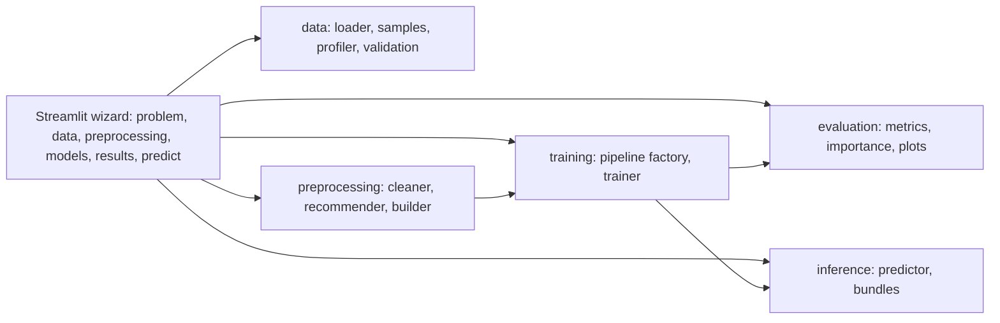

# TabulaML: An Interactive Machine Learning Workbench with Generalized Data Preprocessing and Ensemble Model Comparison

## Abstract
TabulaML is a Streamlit application and Python package that takes a user from a raw table to compared, usable predictive models. The user picks classification or regression, uploads any CSV/Excel file or loads a Sri Lankan sample dataset, reviews an automatically generated and explained preprocessing pipeline, trains any combination of 18 individual models (linear, tree, bagging, boosting, SVM, KNN and ANN) plus voting, stacking and a Random Forest + ANN hybrid, compares them on cross-validated and held-out metrics, and uses a chosen model for single or batch predictions. The preprocessing engine is schema-driven: it contains no dataset-specific code and builds a different leakage-safe pipeline for tree-based and scale-sensitive models. The same code path is tested on 12 very different datasets, including randomly generated mixed-type tables. A repeated-cross-validation benchmark compares Random Forest with XGBoost, LightGBM and CatBoost on two genuine public Sri Lankan datasets, two synthetic Sri Lankan-context datasets and three standard benchmarks.

## 1. Problem
Comparing Random Forest with other ensemble learners on a new tabular dataset normally means writing new code every time: cleaning messy columns, choosing encodings, imputing missing values, handling class imbalance, avoiding data leakage, training several models, comparing metrics and building a way to predict. Preprocessing and leakage control are the most error-prone parts, and they are usually hard-coded to one dataset. The goal of TabulaML is one tool in which all of this is driven by the data's schema and the user's choices, never by code written for a particular dataset.

## 2. Objectives
1. A schema-driven preprocessing engine that supports different tabular datasets without dataset-specific code.
2. Automatic recommendations with an explanation for every decision, plus Custom overrides per column.
3. Leakage-safe validation: every learned step is fitted on training folds only, and the test set is held out before any fitting.
4. Classification and regression with individual models, bagging, boosting, voting, stacking and an RF + ANN hybrid.
5. Comparative evaluation (leaderboard, cross-validation spread, test metrics, diagnostic plots, feature importance) and usable predictions.
6. Genuine public Sri Lankan datasets in the standard workflow, and a comparison of Random Forest with gradient-boosting methods on them.

## 3. Background
- **Random Forest** (Breiman, 2001) averages many decorrelated decision trees, each grown on a bootstrap sample with random feature subsets at each split. **Bagging** is the same idea without the feature subsampling. **Extra Trees** also randomise the split thresholds.
- **Gradient boosting** (Friedman, 2001) fits trees sequentially to the residual errors of the ensemble so far. **XGBoost** (Chen & Guestrin, 2016) adds regularisation and efficient split finding. **LightGBM** (Ke et al., 2017) grows trees leaf-wise using histogram binning. **CatBoost** (Prokhorenkova et al., 2018) uses ordered boosting and symmetric trees to reduce prediction shift.
- **Stacking** (Wolpert, 1992) trains a meta-model on out-of-fold predictions of base models. **Voting** averages their predictions.
- **Target leakage** occurs when a feature, or a preprocessing statistic, carries information that would not be available at prediction time. Two examples are a disconnection date in a churn table, and a scaler fitted on the full dataset before cross-validation.

## 4. Data
| Dataset | Origin | Task | Rows | Notes |
|---|---|---|---|---|
| Colombo weekly dengue (`lk_colombo_dengue`) | **Real, public.** R package *colmozzie* (T. Talagala), from the Epidemiology Unit's Weekly Epidemiological Reports. CC0 | Regression: weekly notified cases | 279 | Weekly weather variables. Lagged cases and 4-week rainfall were derived from past weeks only |
| Sri Lankan telco churn (`lk_telco_churn`) | **Real, public.** Kaggle, L. Jayawardena: a large Sri Lankan operator, Jan-Mar 2023. CC0 | Classification: churn | 15,000 stratified sample of 65,005 | First-month usage of 12 services. Includes a real post-outcome leakage column. Built locally with `scripts/fetch_public_datasets.py` (Kaggle login needed) |
| Synthetic telecom churn | **Synthetic**, Sri Lankan context | Classification | 4,999 | Deliberately messy, with a planted leak (`disconnection_date`) |
| Synthetic hospital length of stay | **Synthetic**, Sri Lankan context | Regression | 2,999 | Right-skewed target, with a planted leak (`total_bill_lkr`) |
| Breast cancer, Wine, Diabetes | Public sklearn benchmarks | Cls / multiclass / regression | 569 / 178 / 442 | Generalisation evidence |

The synthetic datasets exist to stress-test preprocessing. They are labelled "Synthetic" everywhere, and no claim about Sri Lanka is drawn from them.

## 5. System design
The system is layered. The Streamlit UI calls a pure Python package, and the package never imports Streamlit.

Each model is one pipeline:

`DataCleaner -> ColumnTransformer (built for the model family) -> [SMOTE / undersampler] -> model`

Regression with a skewed non-negative target is wrapped in `TransformedTargetRegressor(log1p)`. Voting and stacking combine complete per-model pipelines, so each base learner keeps the preprocessing that suits it.

**Leakage-safe flow:** drop rows with a missing target and exact duplicates (stateless), then split train/test (stratified for classification), then run k-fold cross-validation of the whole pipeline on the training set, then fit on the training set, then score once on the test set. Because every learned step lives inside the pipeline, imputers, encoders, scalers, outlier bounds, skew transforms, target encoders and samplers are refitted inside every fold. A test (`test_learned_steps_never_see_test_or_validation_rows`) inserts a spy transformer that records the rows each `fit` sees, and asserts that no test or validation row ever reaches it.

## 6. Generalized preprocessing
| Concern | Behaviour |
|---|---|
| Cleaning | Trim whitespace. Turn `?`, `NA`, `null`, `-` and similar into missing. Parse `Rs. 1,250` / `LKR 2,000` / `12%` as numbers. Map yes/no/y/n/true/false to 0/1. Parse mixed date formats and time zones. Merge spelling variants of categories. The plan is learned on training data and reused at prediction time |
| Type detection | Numeric, categorical, boolean, datetime, identifier (unique, ID-like name or row counter), constant, free text. Every type can be overridden by the user |
| Leakage detection | Flags features that are identical to the target, whose missingness predicts it (AUC ≥ 0.98), that are almost perfectly related to it (AUC ≥ 0.98 or \|r\| ≥ 0.95), or whose categories map one-to-one onto it. All three planted or real leaks are flagged; ordinary features are not |
| Missing values | Median imputation plus a missing indicator (numeric), a `__missing__` category (categorical), most frequent (boolean), KNN optional |
| Categorical | Low cardinality: one-hot (scale-sensitive models) or ordinal (trees), with rare levels grouped. High cardinality: cross-fitted target encoding. Unseen levels never crash |
| Numeric | Scale-sensitive models only: Yeo-Johnson on columns skewed in the training fold, extreme-outlier clipping (3×IQR), standard scaling |
| Imbalance | Class weights recommended when the smallest class is under 20 %. SMOTE (with k adapted to the fold) or undersampling available |
| Target | Labels encoded and decoded. `log1p` recommended for skewed non-negative regression targets |

**Evidence of generality:** the same code path (Automatic config, then train RF + LightGBM + a linear model, then batch prediction) passes on 12 datasets. These are three sklearn benchmarks, the Sri Lankan samples and six seeded random tables with random column types, cardinalities (2-80 levels) and missingness (0-40 %). A further test runs recommend, build and transform for both model families on six datasets.

## 7. Models
Linear and Logistic Regression, Ridge, Lasso, Elastic Net, Decision Tree, Random Forest, Extra Trees, Bagging, AdaBoost, Gradient Boosting, Histogram GB, XGBoost, LightGBM, CatBoost, SVM, KNN, MLP (ANN), Voting, Stacking, and an **RF + ANN hybrid**. In the hybrid, a neural network learns the Random Forest's out-of-fold residuals, and the final prediction is the forest's prediction plus the network's correction. Out-of-fold residuals stop the network from fitting the forest's in-sample noise.

## 8. Experimental setup
Every model was evaluated with the same 5-fold × 3-repeat (stratified) cross-validation splits, using the Automatic preprocessing. Primary metrics are ROC-AUC for classification and RMSE for regression; secondary metrics are F1 (macro for multiclass) and R². Random Forest was compared with the best of XGBoost, LightGBM and CatBoost on each dataset using a two-sided Wilcoxon signed-rank test on the 15 paired fold scores. Hyperparameters were library defaults or common settings (300 trees for RF; 400-500 boosting rounds, learning rate 0.05). This is a fair default-versus-default comparison, not a tuned one.

## 9. Results
Full tables: `reports/benchmark_summary.md`. Per-fold scores: `reports/benchmark_results.csv`. The real telco dataset needs a Kaggle login and was **not** fetched when these numbers were produced, so it is not in this table. Running `python scripts/fetch_public_datasets.py telco` and then `python scripts/benchmark.py` adds it automatically.

**Primary metric, mean over 15 paired folds**

| Dataset | Origin | Random Forest | Best booster | Best overall | RF vs best booster (Wilcoxon p) |
|---|---|---|---|---|---|
| Colombo dengue (RMSE, cases/week) | Real, Sri Lanka | **62.38** | CatBoost 62.64 | Random Forest | RF better, p = 0.80 (n.s.) |
| Synthetic length of stay (RMSE, days) | Synthetic | 3.065 | CatBoost 2.919 | Ridge 2.849 | CatBoost better, p < 0.001 |
| Synthetic churn (ROC-AUC) | Synthetic | 0.665 | CatBoost 0.675 | Logistic 0.695 | CatBoost better, p = 0.003 |
| Breast cancer (ROC-AUC) | sklearn | 0.990 | CatBoost 0.994 | Logistic 0.995 | CatBoost better, p = 0.02 |
| Wine, 3 classes (ROC-AUC OvR) | sklearn | 0.998 | CatBoost 0.998 | CatBoost / RF | negligible, p = 0.92 (n.s.) |
| Diabetes (RMSE) | sklearn | 57.86 | CatBoost 58.72 | Ridge 54.94 | RF better, p = 0.28 (n.s.) |

Mean fit times per fold were 0.5-1.4 s for Random Forest and 0.9-2.4 s for CatBoost, the slowest booster.

**Ablation (synthetic churn, Random Forest, held-out test ROC-AUC)**

| Setup | ROC-AUC |
|---|---|
| TabulaML Automatic pipeline (leak excluded) | 0.645 |
| Same pipeline with the leakage column kept | **1.000** (invalid: the column is only known after churn) |
| Naive pipeline: drop rows with any missing value (857 rows, 17 %, lost) and one-hot every column as text | 0.627 |

## 10. Discussion
**Random Forest vs gradient boosting.** No method won everywhere.
- On the **real Colombo dengue data**, which is small (279 weeks) and noisy, Random Forest had the lowest RMSE of all models, statistically tied with CatBoost. LightGBM was the worst booster there: its leaf-wise growth needs more data than 220 training weeks.
- On Diabetes, Random Forest also beat every booster, but not significantly.
- CatBoost was the strongest booster on every dataset, and it beat Random Forest significantly on three: breast cancer, and both synthetic sets. The margins were small (0.004-0.010 ROC-AUC, 0.15 days RMSE).
- These results match the usual picture: with library defaults, boosting gains a little on larger or smoother problems, while Random Forest is very hard to beat on small, noisy datasets and needs no tuning.

**Simple models are competitive.** On four of six datasets a linear model was best or close to best. On the synthetic sets this is expected, because their labels were generated from (log-)linear formulas. On Diabetes and breast cancer it reflects small datasets with mostly monotone effects. This is the main argument for a comparison workbench: the right model depends on the data, and it must be measured, not assumed.

**Preprocessing and leakage matter more than the model choice.** Keeping one leaked column raised the test ROC-AUC from 0.645 to a perfect 1.000. That is a far bigger change than any difference between models, and it is completely invalid. The detector flagged that column (and the planted leak in the length-of-stay data, and the post-outcome column in the real telco data) automatically. The naive pipeline lost 17 % of the rows and scored lower than the automatic one, because it treated `Rs. 1,250` strings, spelling variants and numeric columns as unrelated text categories.

**Strengths and limitations on tabular vs image/text data.** Tree ensembles fit tabular data well: they handle mixed feature types, monotone transformations, interactions and missingness with little preprocessing, and they train quickly on a CPU. On images, audio and free text the signal sits in local structure (neighbouring pixels, word order) that axis-aligned splits on individual raw features cannot use efficiently. There, convolutional and transformer networks that learn representations dominate. Tree ensembles become competitive again only after those networks turn the data into tabular embeddings. TabulaML therefore restricts itself to tabular data, drops long free text by default (offering only simple length and word-count features), and leaves images, audio and text out of scope.

**Hybridisation.** The RF + ANN residual hybrid is included for tabular regression. RF + ARIMA for time series is listed as future work: it needs a time-ordered validation scheme, which this tool deliberately does not mix with random cross-validation.

## 11. Limitations and future work
- The real telco data contains only usage (no price plan, complaints or demographics), covers one operator and one quarter, and must be fetched with a Kaggle login.
- The dengue series is small (279 weeks) and time-ordered, so random cross-validation is optimistic. Forward-chaining validation and an RF + ARIMA hybrid are natural next steps.
- No hyperparameter tuning in the UI yet. SHAP explanations and decision-threshold tuning are planned extensions.
- Scope is tabular classification and regression. Multi-label, ranking, forecasting and unstructured data are out of scope.

## 12. Reproducibility
`pip install -r requirements-dev.txt && pip install -e .`, then `pytest` (unit, integration and a headless UI run of the full wizard), then `python scripts/benchmark.py`. One random seed (42) drives splits, models and samplers. Exact library versions are pinned in `requirements.lock.txt` and recorded in every run report.

## 13. AI-assistance disclosure
Parts of the design, code, tests and documentation of this project were produced with the help of an AI coding assistant (Claude Code), under the author's direction, and then reviewed. *Edit this section to match your course's disclosure requirements.*

## References
- Breiman, L. (2001). Random forests. *Machine Learning*, 45(1), 5-32.
- Chen, T., & Guestrin, C. (2016). XGBoost: A scalable tree boosting system. *KDD*.
- Friedman, J. H. (2001). Greedy function approximation: A gradient boosting machine. *Annals of Statistics*, 29(5).
- Ke, G., et al. (2017). LightGBM: A highly efficient gradient boosting decision tree. *NeurIPS*.
- Prokhorenkova, L., et al. (2018). CatBoost: Unbiased boosting with categorical features. *NeurIPS*.
- Wolpert, D. H. (1992). Stacked generalization. *Neural Networks*, 5(2), 241-259.
- Talagala, T. *colmozzie: Dengue cases and climate variables in Colombo, Sri Lanka* (R package, CC0). https://github.com/thiyangt/colmozzie
- Jayawardena, L. *Real World Customer Churn Dataset in Telco Domain* (Kaggle, CC0). https://www.kaggle.com/datasets/lasaljaywardena/real-world-churn
