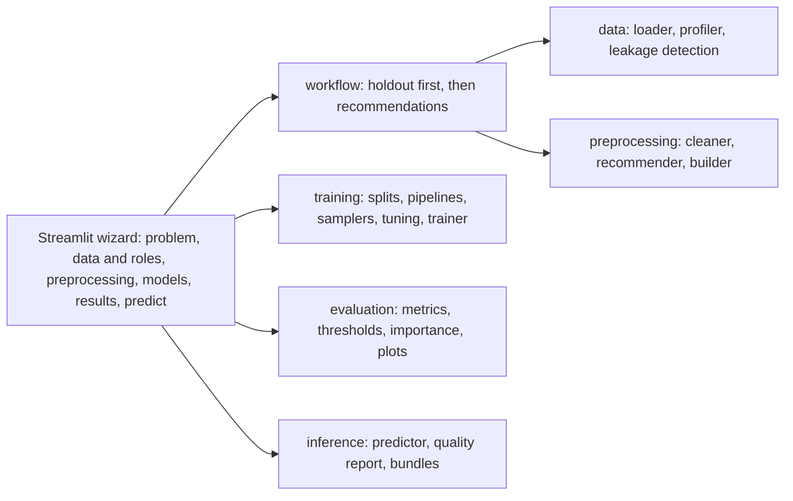
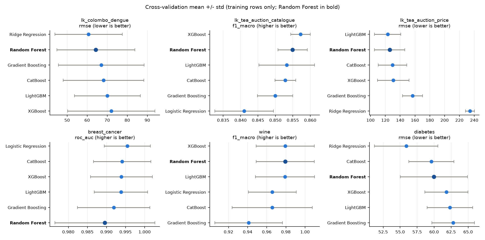

# TabulaML: An Interactive Machine Learning Workbench with Generalized Data Preprocessing and Ensemble Model Comparison

## Abstract
TabulaML is a Streamlit application and Python package that takes a user from a raw table to compared, usable predictive models. The user picks classification or regression, loads a CSV/Excel file or a public Sri Lankan dataset, and chooses how the model should be tested (random, grouped or time-ordered). TabulaML then holds out a test set, recommends an explained preprocessing pipeline from the training rows only, and lets the user review possible leakage. The user trains any mix of 18 individual models plus voting, stacking and a Random Forest + ANN hybrid, with default, manual, random-search or grid-search hyperparameters, and compares them on cross-validation before revealing the held-out test results. The preprocessing engine contains no dataset-specific code. On two genuine public Sri Lankan datasets (Colombo Tea Auction prices, Colombo dengue surveillance) and three standard datasets, Random Forest was as good as or better than the gradient boosters in most comparisons. The validation design and leakage control changed the results far more than the choice of model did.

## 1. Problem
Comparing Random Forest with other ensemble learners on a new tabular dataset normally means writing new code each time: cleaning messy columns, choosing encodings, handling missing values and imbalance, avoiding leakage, training several models, comparing them and making predictions. Preprocessing and validation are where mistakes happen most often, and they are usually hard-coded for one dataset. TabulaML drives all of this from the data's structure and the user's choices.

## 2. Objectives
1. A schema-driven preprocessing engine that works on different tabular datasets without dataset-specific code.
2. Automatic recommendations with a reason for every decision, plus manual overrides.
3. Honest evaluation: a held-out test set created first, recommendations from training rows only, validation that respects groups and time, and a test set that stays locked until the user reveals it.
4. Classification and regression with individual models, bagging, boosting, voting, stacking and an RF + ANN hybrid, with adjustable hyperparameters.
5. Clear comparison and diagnostics, and usable predictions with input checks.
6. Genuine public Sri Lankan datasets, and a comparison of Random Forest with gradient boosting on them.

## 3. Background
- **Random Forest** (Breiman, 2001) averages many decision trees, each trained on a bootstrap sample and using random subsets of features at each split. **Bagging** is the same without feature subsampling. **Extra Trees** also randomise split thresholds.
- **Gradient boosting** (Friedman, 2001) builds trees one after another, each correcting the errors of the previous ones. **XGBoost** (Chen & Guestrin, 2016) adds regularisation, **LightGBM** (Ke et al., 2017) grows trees leaf by leaf on histograms, and **CatBoost** (Prokhorenkova et al., 2018) uses ordered boosting and symmetric trees.
- **Stacking** (Wolpert, 1992) trains a final model on the out-of-fold predictions of base models. **Voting** averages their predictions.
- **Data leakage** means information is used during training that would not be available at prediction time. Examples are a column filled in after the outcome, or test rows influencing preprocessing or model choice.
- **Validation design.** Rows that belong together (the same weekly sale) or follow each other in time must not be split at random, or the model is tested on information it has effectively already seen.

## 4. Data (genuine, publicly available)
| Dataset | Source and licence | Task | Rows | Validation |
|---|---|---|---|---|
| Colombo Tea Auction, catalogue (`lk_tea_auction_catalogue`) | Hugging Face `colombo-tea-auction-prices/cta-price-prediction`: 105 weekly Forbes & Walker broker reports, Nov 2023 - Mar 2026, with Open-Meteo weather. **CC BY 4.0** | Classification, 4 classes (Low Grown, High Grown, Dust, Off-Grade) | 12,233 | Grouped by weekly sale (`sale_id`) |
| Colombo Tea Auction, price (`lk_tea_auction_price`) | Same file | Regression: mid price (LKR/kg) | about 11,800 with a price | Grouped by weekly sale |
| Colombo dengue (`lk_colombo_dengue`) | R package *colmozzie* (T. Talagala), from the Epidemiology Unit's Weekly Epidemiological Reports. **CC0** | Regression: weekly notified cases | 279 weeks | Time-ordered by `week_start` |
| Sri Lankan telco churn (`lk_telco_churn`) | Kaggle, L. Jayawardena, large Sri Lankan operator, 2023. **CC0** | Classification: churn | 15,000 (sample) | Random. Needs a Kaggle login; fetched on demand |
| Breast cancer, Wine, Diabetes | scikit-learn public datasets | Classification / multiclass / regression | 569 / 178 / 442 | Random |

The tea data contains a genuine structural leak: each tea `category` belongs to exactly one catalogue. The dengue data has lagged case counts built from earlier weeks only. Because it also uses same-week weather, the dengue task estimates the current week's cases (a nowcast) rather than forecasting the next week.

## 5. System design
The system is layered: a Streamlit UI calls a pure Python package, which never imports Streamlit.

Each model is one pipeline:

`DataCleaner (user types, number format) -> ColumnTransformer (built for the model family) -> [sampler] -> model`

The flow that keeps the evaluation honest:
1. Drop rows with a missing target and exact duplicate rows.
2. **Create the held-out test set first**: random, whole groups, or the latest rows in time.
3. Make every target-based recommendation (leakage, imbalance, target transform) from the training rows only.
4. Cross-validate each model on the training rows with the matching scheme: K-fold, group K-fold, or forward time splits. Hyperparameter searches use the same folds.
5. Fit on all training rows and score **once** on the test rows. The UI keeps these scores hidden until the user reveals them.

Tests prove that no test row reaches any fitted step, that group and time splits never mix groups or train on the future, and that corrupting only the test labels does not change the automatic configuration.

## 6. Generalized preprocessing
| Concern | Behaviour |
|---|---|
| Cleaning | Trim text; turn `?`, `NA`, `null` and similar into missing; parse `Rs. 1,250`, `12%` and decimal-comma numbers; keep codes with leading zeros (`00100`) as text; map yes/no style values to 0/1; parse mixed date formats; merge spelling variants. The user's chosen column types are respected, and values that fail to parse are counted and reported |
| Type detection | Numeric, categorical, boolean, datetime, identifier, constant, free text. Every type can be changed |
| Leakage | Flags columns that copy the target, whose missingness predicts it, that are almost perfectly related to it, or whose categories map one-to-one onto it. The user then answers "Will this be known at prediction time?" |
| Missing values | Median plus a missing indicator (numeric), a `__missing__` category (categorical), most frequent (boolean); KNN optional |
| Categories | One-hot (linear, SVM, KNN, ANN) or ordinal (trees), with rare levels grouped; target encoding for many levels. Unseen levels never crash |
| Numbers | For scale-sensitive models only: skew correction (Yeo-Johnson), extreme-outlier clipping, scaling |
| Imbalance | Class weights, random oversampling, SMOTE (SMOTE-NC keeps category columns valid), undersampling. The method each model actually used is shown |
| Target | Labels encoded and decoded; `log1p` (only for targets above -1) or Yeo-Johnson for skewed regression targets |

The same unchanged code trains and predicts on 12 different datasets in the test suite, including six randomly generated tables with random column types and missing values.

## 7. Models and hyperparameters
The models are Linear and Logistic Regression, Ridge, Lasso, Elastic Net, Decision Tree, Random Forest, Extra Trees, Bagging, AdaBoost, Gradient Boosting, Histogram GB, XGBoost, LightGBM, CatBoost, SVM, KNN and MLP (ANN), plus Voting, Stacking and two hybrids:
- **RF + ANN** (tabular regression): a neural network learns the Random Forest's out-of-fold errors and adds a correction.
- **RF + ARIMA** (forecasting): ARIMA(p, d, q) models the series' own time pattern (trend and autocorrelation). A Random Forest then learns ARIMA's residuals from the lag, rolling-mean, calendar and lagged weather features. The forecast is ARIMA's forecast plus the forest's correction.

Forecasting mode also has two baselines that every model must beat: **naive** (the last known value) and **seasonal naive** (the value one season ago).

Each model lists its main hyperparameters with a short explanation, such as number of trees, depth, learning rate, leaves or regularisation. There are three modes:
- **Default:** sensible library defaults.
- **Manual:** the user sets each value.
- **Random search:** tries N random combinations, scored with the same cross-validation on the training rows only, and keeps the best.
- **Grid search:** tries every combination of a few values per chosen setting, centred on the defaults (at most 200 combinations), with the same cross-validation.

Regularisation is exposed wherever a model has it: L1 / L2 / elastic net for logistic regression (the `saga` solver is selected automatically for L1 and elastic net), alpha for Ridge / Lasso / Elastic Net, `reg_alpha`, `reg_lambda` and `gamma` for XGBoost, `reg_alpha` and `reg_lambda` for LightGBM, `l2_leaf_reg` for CatBoost, `l2_regularization` for HistGB, cost-complexity pruning for the decision tree, leaf sizes and depth for the forests, C for SVM, and the L2 penalty `alpha` for the neural network.

The chosen values appear in the leaderboard, the report and the saved model.

## 8. Results
Settings: 5-fold cross-validation on the training rows with each dataset's validation design, then the held-out test set. Library defaults, Automatic preprocessing, seed 42. Full tables are in `reports/benchmark_summary.md`.

**Main metric (CV mean on training rows | held-out test)**

| Dataset (validation) | Metric | Random Forest | XGBoost | LightGBM | CatBoost | Linear |
|---|---|---|---|---|---|---|
| Colombo dengue (time-ordered) | RMSE ↓ | **64.3** \| **65.2** | 72.0 \| 68.1 | 70.1 \| 86.8 | 68.1 \| 69.3 | 60.7 \| 74.2 |
| Tea catalogue (grouped) | macro-F1 ↑ | 0.855 \| **0.856** | **0.857** \| 0.852 | 0.853 \| 0.845 | 0.853 \| 0.851 | 0.841 \| 0.843 |
| Tea price (grouped) | RMSE ↓ | 125.9 \| **102.3** | 130.6 \| 115.9 | **123.2** \| 106.4 | 129.6 \| 112.9 | 234.3 \| 255.9 |
| Breast cancer (random) | ROC-AUC ↑ | 0.990 \| 0.994 | 0.994 \| 0.995 | 0.994 \| 0.989 | 0.994 \| **0.997** | **0.996** \| 0.995 |
| Wine (random) | macro-F1 ↑ | **0.979** \| **1.000** | **0.979** \| 0.949 | 0.979 \| 0.949 | 0.966 \| 0.923 | 0.966 \| 0.946 |
| Diabetes (random) | RMSE ↓ | 60.0 \| 54.8 | 61.8 \| 56.9 | 62.3 \| 57.7 | 59.6 \| **53.6** | **55.9** \| 53.8 |

**Random Forest against each booster, fold by fold.** A model counts as "better" only when it wins at least 4 of the 5 folds.
- **Random Forest better:**
  - dengue vs XGBoost (5/5) and LightGBM (4/5);
  - tea catalogue vs CatBoost (4/5);
  - tea price vs CatBoost (5/5);
  - diabetes vs XGBoost and LightGBM (4/5 each).
- **Booster better:**
  - tea catalogue: XGBoost (4/5, by 0.002 F1);
  - tea price: LightGBM (4/5);
  - breast cancer: XGBoost (4/5, by 0.004 AUC).
- **About the same:** the remaining nine comparisons, including every comparison on Wine.

**Ablation (tea catalogue, Random Forest, macro-F1)**

| Setup | CV | Test |
|---|---|---|
| TabulaML: grouped validation, leaky `category` excluded | 0.855 | 0.856 |
| Same, but `category` kept | **1.000** | **1.000** (invalid: the column already encodes the answer) |
| Random split that ignores the weekly-sale groups | 0.809 | 0.821 |

### 8.1 Forecasting and the RF + ARIMA hybrid (Colombo dengue)
Setup:
- Forecasting mode with a horizon of 1 and of 4 weeks.
- Features: target lags h … h+3, seasonal lag 52, a 4-week rolling mean, calendar parts, and weather lagged by h.
- Time-ordered 5-fold CV on the training weeks; the test set is the latest 20 % of weeks.
- Every model, including ARIMA inside the hybrid, only uses values known h weeks earlier.

Reproduce with `python scripts/forecast_benchmark.py`; full table in `reports/forecast_summary.md`.

| Model | h = 1: CV RMSE | h = 1: test RMSE | h = 4: CV RMSE | h = 4: test RMSE |
|---|---|---|---|---|
| Naive (last known value) | 62.6 | 62.1 | 85.8 | 79.0 |
| Seasonal naive (52 weeks) | 90.1 | 98.7 | 92.5 | 99.1 |
| Ridge | 72.9 | 83.9 | 94.4 | 92.9 |
| Random Forest | 63.6 | 67.3 | 76.2 | 83.7 |
| XGBoost | 68.6 | 71.5 | **74.1** | 80.5 |
| **Hybrid RF + ARIMA** | **61.6** | **60.4** | 74.7 | **72.8** |

The naive forecast is hard to beat for weekly dengue counts, because next week is usually close to this week. Random Forest and XGBoost alone did *not* beat it on the test weeks. The hybrid did beat it, by 2.8 % at one week and 7.8 % at four weeks: ARIMA captures the series' own momentum, and the forest corrects it with weather and seasonality. A first version of the hybrid forecast every test week from the end of the training data (up to a year ahead), which made it look poor (test RMSE 93.8). Giving ARIMA the same information as the other models, values up to h weeks back, fixed this. It shows that a fair comparison needs the *same information* for every model, not only the same split.

## 9. Discussion
**Random Forest vs gradient boosting.** There was no single winner. On the two real Sri Lankan regression tasks, Random Forest gave the best held-out test RMSE: dengue 65.2 cases per week, tea price 102.3 LKR. In cross-validation it beat XGBoost and LightGBM on the small, noisy dengue series. Boosters edged ahead in a few comparisons, but by small margins (0.002 F1 on the tea catalogue, 0.004 AUC on breast cancer). With default settings, Random Forest is a very strong and low-maintenance choice for tabular data; boosting can win slightly, especially after tuning.

**Simple models still matter.** A linear model had the best cross-validation score on dengue, breast cancer and diabetes. On dengue its test error was much worse (74.2), which shows why the final test set should be looked at only once, at the end.

**Validation design and leakage matter more than the model.** Keeping the leaky `category` column gave a perfect but meaningless score of 1.000. Leakage changed the result far more than any choice between models did. The validation design also changed the estimate: when the weekly-sale groups were ignored, the score dropped to 0.809 CV and 0.821 test, because both the split and the recommended features change. Grouped validation is the design that matches the real use: predicting lots from a new weekly sale. This is why TabulaML asks how the model should be tested before it recommends anything.

**Tabular vs image/text data.** Tree ensembles fit tabular data well: they handle mixed types, missing values and interactions with little preparation and train quickly on a CPU. In images, audio and text, the information sits in local structure (neighbouring pixels, word order) that trees on raw features cannot use well, so neural networks dominate there. TabulaML is therefore limited to tabular data.

**Hybridisation.** Both hybrids from the brief are implemented. RF + ANN is available for tabular regression. RF + ARIMA is available in forecasting mode, together with the naive baselines that show whether any model has learned more than "same as last week" (see §8.1).

## 10. Limitations and future work
- The telco data needs a Kaggle login, so it was not part of this benchmark run. Fetch it with `scripts/fetch_public_datasets.py telco`.
- Tea and dengue are aggregate market and surveillance data, not individual patient records.
- Only default hyperparameters were benchmarked. Random and grid search are available in the app, but they were not used here, to keep the comparison simple and equal.
- The RF + ARIMA hybrid supports one series at a time and a fixed, user-set ARIMA order. Seasonal ARIMA and automatic order selection are left out to stay within the course scope.
- Possible next steps: SHAP explanations and an HTML report export.

## 11. Reproducibility
`pip install -r requirements-dev.txt && pip install -e .`, then `pytest` (312 tests, about 96 % coverage; includes headless runs of the whole app) and `python scripts/e2e_playwright.py` (a browser walk-through of every problem type on desktop and phone), then `python scripts/benchmark.py`. The public data can be rebuilt with `python scripts/fetch_public_datasets.py public`. Versions are pinned in `requirements.txt` and recorded in every run report. Deployment instructions are in `docs/DEPLOYMENT.md`; the deployed app is at https://tabulaml.streamlit.app.

## 12. AI-assistance disclosure
Parts of the design, code, tests and documentation were produced with the help of an AI coding assistant, under the author's direction, and reviewed. *Edit this section to match your course's disclosure requirements.*

## References
- Breiman, L. (2001). Random forests. *Machine Learning*, 45(1), 5-32.
- Chen, T., & Guestrin, C. (2016). XGBoost: A scalable tree boosting system. *KDD*.
- Friedman, J. H. (2001). Greedy function approximation: A gradient boosting machine. *Annals of Statistics*, 29(5).
- Ke, G., et al. (2017). LightGBM: A highly efficient gradient boosting decision tree. *NeurIPS*.
- Prokhorenkova, L., et al. (2018). CatBoost: Unbiased boosting with categorical features. *NeurIPS*.
- Wolpert, D. H. (1992). Stacked generalization. *Neural Networks*, 5(2), 241-259.
- Colombo Tea Auction prices dataset (CC BY 4.0). https://huggingface.co/datasets/colombo-tea-auction-prices/cta-price-prediction
- Talagala, T. *colmozzie: Dengue cases and climate variables in Colombo, Sri Lanka* (CC0). https://github.com/thiyangt/colmozzie
- Jayawardena, L. *Real World Customer Churn Dataset in Telco Domain* (CC0). https://www.kaggle.com/datasets/lasaljaywardena/real-world-churn
